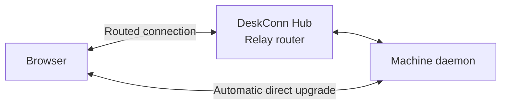

# DeskConn Web

Browser and desktop client for [DeskConn](https://github.com/xconnio/deskconn).
Access your computers, open terminals, manage files, and use remote apps from a
browser or the [desktop app](#desktop-app) for Linux, macOS, and Windows.

Use the hosted app at [web.deskconn.com](https://web.deskconn.com), download the
desktop app from [Releases](https://github.com/xconnio/deskconn-web/releases),
or connect either to your own DeskConn deployment.

## Capabilities

- **Terminals:** open interactive shells on your machines.
- **Files:** browse, upload, download, and edit remote files.
- **Apps:** launch machine applications and manifest-based interfaces.
- **Access management:** manage machine sharing and invitations.
- **Direct connections:** automatically attempt a peer-to-peer upgrade while the
  routed connection makes the machine available immediately.

## How it connects

Built with Vue, TypeScript, and [XConn](https://github.com/xconnio/xconn), the app
uses browser networking and a shared Rust/WASM protocol engine.



The routed path uses WebTransport; direct connections currently use WebRTC.
If the direct attempt fails, the app stays routed. If an established direct
session drops, it disconnects and a new connection starts routed again.

A browser with WebTransport support is required. For local certificates and
self-hosting configuration, see [deployment](docs/deployment.md).

## Local development

Use Node.js 22.22.2+, 24.15.0+, or 26+ within the supported ranges in
[package.json](package.json).

```sh
npm ci
cp .env.example .env.local
npm run dev
```

Configure `.env.local` for your DeskConn Hub. A working account deployment also
needs [DeskConn Management](https://github.com/xconnio/deskconn-management), its
database, and the registration identity configured by that deployment. Attach a
machine with DeskConn to use its tools.

The default connection settings target a local Hub. See the
[configuration guide](docs/deployment.md#configuration) for each setting.

XConn is installed from npm with its compiled WASM. Normal app builds require
neither a Rust toolchain nor a sibling XConn checkout.

## Build and checks

```sh
npm run type-check
npm run build
npm run preview
```

`build` includes type checking and writes the production app to `dist/`.
`preview` serves that build locally; it is not a production deployment server.

Use `npx eslint .` for a read-only lint check. `npm run lint` applies fixes.
See [testing](docs/testing.md) for browser transport and backend interoperability
tests, and [deployment](docs/deployment.md) for Docker and runtime configuration.

## Desktop app

The same client is packaged with Electron for Linux, macOS, and Windows.
Download it from [Releases](https://github.com/xconnio/deskconn-web/releases).

```sh
make run-desktop     # Vite dev server inside Electron
make build-desktop   # installers for the current OS in release/
```

See [desktop](docs/desktop.md) for installation notes and configuration.
